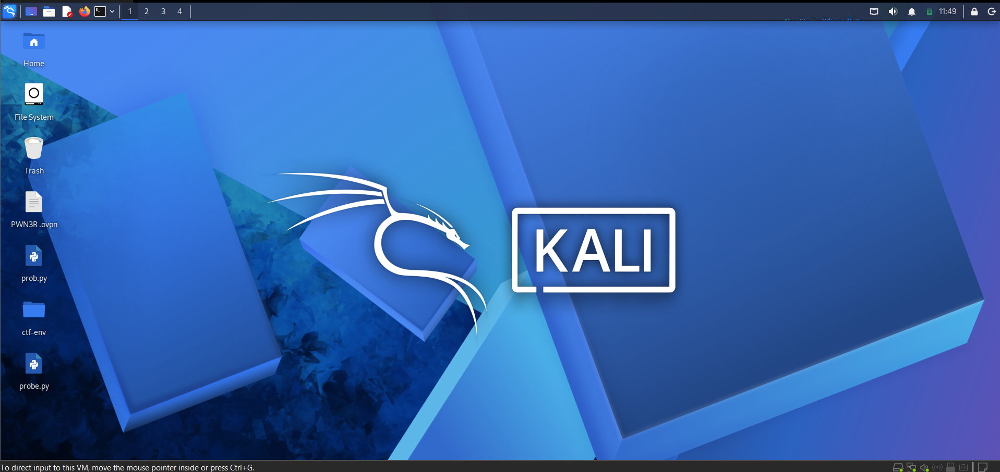

# 🔐 Cybersecurity Lab Setup — Networkwalks Week 1

**A practical cybersecurity lab setup using VMware/VirtualBox and Kali Linux.**

This repository documents my Week 1 practical project for the NETWORKWALKS Cybersecurity Internship. It covers virtual machine configuration, network setup, and preparation of a Linux-based environment for authorized cybersecurity practice.

---

## 📌 Table of Contents

- [Project Overview](#-project-overview)
- [Objectives](#-objectives)
- [Lab Configuration](#-lab-configuration)
- [Setup Procedure](#-setup-procedure)
- [Screenshots](#-screenshots)
- [Network Verification](#-network-verification)
- [Challenges and Troubleshooting](#-challenges-and-troubleshooting)
- [Key Learnings](#-key-learnings)
- [Security and Ethical Use](#-security-and-ethical-use)
- [Author](#-author)

---

## 🎯 Project Overview

The objective of this project is to prepare a virtual cybersecurity environment using Kali Linux and VMware.

A properly configured virtual lab provides a controlled environment for learning Linux administration, virtual networking, network troubleshooting, and cybersecurity tools without intentionally targeting unauthorized systems.

## ✅ Objectives

- Prepare a Kali Linux virtual machine.
- Configure virtual machine memory and processor resources.
- Set up a NAT Network for virtual networking.
- Configure Kali Linux network settings.
- Identify the commands required to verify IP addressing, connectivity, and DNS.
- Document the lab configuration with screenshots.

## ⚙️ Lab Configuration

| Component | Configuration |
|---|---|
| Virtualization Platform | VMware |
| Security Operating System | Kali Linux |
| Virtual Machine Memory | Refer to the configuration screenshot |
| Virtual Machine Processors | Refer to the configuration screenshot |
| Network Mode | NAT Network |
| Network Configuration | Refer to the configured Kali settings |

**Note:** Network addresses and connectivity results should be documented according to the actual configuration of the virtual machine.

---

## 🪜 Setup Procedure

### Step 1 — Prepare the Virtual Machine

Prepare the Kali Linux virtual machine in VMware and check its hardware resource allocation.

### Step 2 — Configure Memory and Processors

Review the virtual machine's allocated memory and processor settings to ensure the configuration is appropriate for the available host hardware.

### Step 3 — Configure the NAT Network

Configure the virtual network adapter to use the intended NAT Network. Confirm that the selected network matches the network configuration used by Kali Linux.

### Step 4 — Configure Kali Linux

Start Kali Linux and configure the network settings according to the lab's intended IPv4 configuration.

Useful commands for inspecting the configuration:

```bash
ip a
ip route
```

The first command displays network interfaces and IP addresses. The second displays the system's routing table.

---

## 📸 Screenshots

The following screenshots document the virtual machine setup and network configuration.

### 1. Virtual Lab Dashboard



*Overview of the lab environment.*

### 2. Memory and Processor Configuration


*Virtual machine resource allocation in VMware.*

### 3. NAT Network Configuration


*Virtual network configuration used for the lab.*

### 4. Configured Kali Linux


*Kali Linux configuration for the cybersecurity lab.*

---

## 🔎 Network Verification

The following commands can be used to verify the lab configuration.

| Test | Command | Purpose |
|---|---|---|
| IP Configuration | `ip a` | Inspect network interfaces and assigned IP addresses |
| Routing Table | `ip route` | Identify the default gateway and routes |
| Gateway Connectivity | `ping -c 4 10.0.0.1` | Test connectivity to the intended gateway |
| Internet Connectivity | `ping -c 4 8.8.8.8` | Test connectivity to a public IP address |
| DNS Resolution | `nslookup networkwalks.com` | Check domain name resolution |
| Nmap Availability | `nmap --version` | Check whether Nmap is installed |

**Verification note:** A command's expected result is not proof that the test passed. Record successful results only after running the commands in the configured environment. Replace the example gateway if your actual network uses a different address.

---

## 🛠️ Challenges and Troubleshooting

During virtual lab setup, common issues can include:

- Incorrect virtual machine resource allocation.
- A network adapter connected to the wrong virtual network.
- Incorrect IPv4, subnet mask, gateway, or DNS settings.
- Internet connectivity or DNS resolution failures.
- Virtual machine startup problems.

A systematic troubleshooting approach involves checking the virtual machine settings, inspecting the routing table, and testing network connectivity in sequence.

Document any issue encountered and its actual solution as the lab progresses.

---

## 💡 Key Learnings

This project provides practical exposure to:

- Virtual machine configuration and resource allocation.
- NAT-based virtual networking.
- Kali Linux network configuration.
- IPv4 addressing and routing fundamentals.
- Basic connectivity and DNS troubleshooting.
- Technical documentation using GitHub Markdown.

---

## 🔒 Security and Ethical Use

This lab is intended for educational purposes and authorized cybersecurity testing only.

Only test systems you own or have explicit permission to assess. Keep experimental activities within the intended lab environment.

---

## 👤 Author

**Abdul Ahad**

- GitHub: [AhadAbbasi996](https://github.com/AhadAbbasi996)
- Project: NETWORKWALKS Cybersecurity Internship — Week 1
- Repository: [Cybersecurity Lab Setup](https://github.com/AhadAbbasi996/NETWORKWALKS-AhadAbbasi996-B084-WK1-PM1-CYBERSECURITY-LAB-SETUP)

---

*Documented as part of my cybersecurity learning journey with NETWORKWALKS.*
